# Strand 使用说明书

Strand 是一个桌面 Git 客户端，功能和布局照着 JetBrains IDE（IntelliJ IDEA、WebStorm 等）的 Git 集成来做，几乎每一步操作都能用 ⌘Z 撤销。这本说明书对应 **0.1.9 版**，按日常用到的顺序讲：先装好、认识界面，再讲看历史、提交、分支、同步，最后是冲突、撤销和各种工具。

- 每节开头一句话说这一节能做什么，后面是具体步骤和截图。
- 快捷键按 macOS 写：Windows 上 ⌘ 换成 Ctrl，⌥ 换成 Alt。
- 界面支持中文和英文，本书按中文界面写，按钮名都用界面上的原文。
- 想快速找某个操作：在 Strand 里按 ⌘K 打开命令面板，输入几个字就能找到。

## 目录

1. [开始之前](#1-开始之前)
2. [认识主界面](#2-认识主界面)
3. [查看历史](#3-查看历史)
4. [提交改动](#4-提交改动)
5. [分支](#5-分支)
6. [和远程同步](#6-和远程同步)
7. [解决冲突](#7-解决冲突)
8. [撤销和重做](#8-撤销和重做)
9. [暂存架和贮藏](#9-暂存架和贮藏)
10. [整理提交](#10-整理提交)
11. [文件和逐行追溯](#11-文件和逐行追溯)
12. [更多工具](#12-更多工具)
13. [设置和更新](#13-设置和更新)
14. [快捷键和常见问题](#14-快捷键和常见问题)

## 1. 开始之前

装好 Strand 和 Git 2.30 以上版本，打开一个仓库就能用。Strand 的写操作都交给你电脑上的 Git，所以钩子、签名、凭据和你在终端里用的是同一套。

### 下载和安装

| 系统 | 下载哪个文件 | 说明 |
| --- | --- | --- |
| macOS（Apple 芯片） | `Strand_0.1.9_aarch64.dmg` | 打开后把 Strand 拖进“应用程序” |
| Windows 10 / 11（64 位） | `Strand_0.1.9_x64-setup.exe` | 安装程序，推荐 |
| Windows | `Strand_0.1.9_x64_en-US.msi` | 给需要 MSI 的公司环境 |
| Windows | `Strand_0.1.9_x64_portable.exe` | 免安装，双击就能用 |

文件在 [GitHub Releases](https://github.com/calabli/Strand/releases/latest) 上。装好之后不用再手动下载：有新版本时 Strand 会在右下角提示，点“下载并安装”即可（见第 13 节）。

**macOS 第一次打开**：安装包还没有经过苹果公证，双击会提示“无法验证开发者”。先关掉提示，打开“系统设置 → 隐私与安全性”，在底部点“仍要打开”，之后就能正常双击打开了。

**需要 Git**：电脑上没有 Git 或版本低于 2.30 时，Strand 会给出提示。macOS 可以在终端运行 `xcode-select --install` 或用 Homebrew 安装，Windows 从 git-scm.com 下载。从访达或程序坞启动时，Strand 会读取终端的 PATH，用的是和终端里同一个 git。

### 打开或克隆仓库

第一次打开是欢迎页（图 1）。

1. **选择文件夹**：选一个 Git 仓库所在的文件夹。
2. **克隆仓库…**：填地址和放在哪个文件夹，文件夹名按地址自动填；克隆时显示进度，可以停止，完成后直接打开。
3. **最近打开**：点一下就重新打开，星号固定在上面。

之后在主窗口里，点工具栏最左边的仓库名就能切换到别的仓库。想同时开几个仓库，就在这个列表里悬停一个仓库、点“在新窗口中打开”图标，或在命令面板里搜“在新窗口中打开仓库…”：每个窗口开一个仓库，互不影响。退出 Strand（⌘Q）后再打开，上次开着的仓库会全部回来（各自一个窗口）；只想收起某个仓库，就先关掉它的窗口再退出。这跟着设置里的“启动时打开上次的仓库”。如果还没设置提交用的用户名和邮箱，提交面板上会提示“提交会失败”，点“去设置”填上即可。

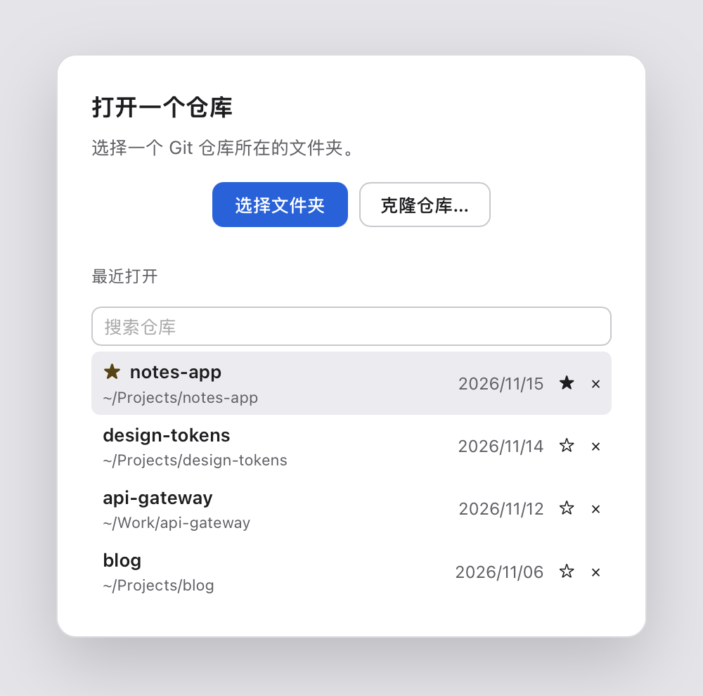

*图 1　欢迎页：打开、克隆或从最近打开的仓库里选一个*

## 2. 认识主界面

主窗口从左到右分三块：左边是提交面板，中间是分支树和日志，右边是选中提交的详情（图 2）。三块之间的分隔线都能拖动调宽，双击恢复默认宽度。

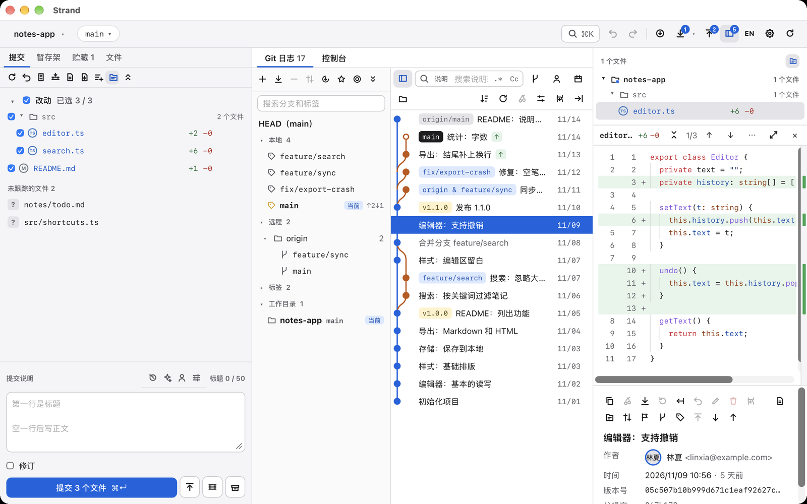

*图 2　主窗口：左边提交面板，中间分支树和日志，右边提交详情*

| 区域 | 位置 | 用来做什么 |
| --- | --- | --- |
| 工具栏 | 顶部 | 从左到右：仓库名（切换仓库）、当前分支（打开分支弹窗）、搜索框 ⌘K、撤销和重做、抓取、拉取、推送、提交面板开关、语言、设置、重新读取仓库 |
| 左侧面板 | 左边 | 四个标签：**提交**（改动和提交说明）、**暂存架**、**贮藏**、**文件**（项目里的文件树和内容搜索） |
| 分支树 | 中间左侧 | 本地分支、远程分支、标签、工作目录、子模块；单击只看这个分支，双击切换，右键看全部操作 |
| 日志 | 中间 | 上面是过滤栏，下面是带图谱的提交列表，最底下是操作时间线 |
| 提交详情 | 右边 | 选中提交的改动文件、差异、作者和说明，以及一排操作图标 |

中间上方是标签页：**Git 日志**、**控制台**，以及打开的文件和差异（每个差异一个标签，最多 10 个）。窗口标题显示仓库名和当前分支，窗口大小和位置下次打开时还原。打开差异、文件或控制台时，右边的详情会收起来，把宽度让给中间。

几个小标记值得认一下：

- 工具栏拉取、推送图标上的数字是落后、领先的提交数；推送角标变成警示色表示需要强制推送。
- 分支树里分支后面的 ↑2↓1 是和跟踪的远程分支相比领先、落后几个。
- 日志里空心圆是当前所在的提交，提交行上的小箭头表示还没推送。
- 鼠标停在任何图标上都会显示它的名字；灰掉的按钮悬停会说明为什么不能用。

## 3. 查看历史

日志列出所有分支的提交和它们之间的图谱，单击一个提交，右边就显示它改了哪些文件。大仓库也能很快打开：8.6 万个提交的仓库约 0.1 秒出第一屏。

### 过滤和搜索

过滤栏在日志上方（图 3），条件可以叠加：

| 条件 | 怎么用 |
| --- | --- |
| 搜索 | 按 ⌘F 聚焦。左边切换“说明 / 改动”：搜提交说明，或搜加进、删掉某段文字的提交；右边的 `.*` 是正则，`Cc` 是区分大小写 |
| 分支 | 只看一个分支；在分支树里单击分支效果一样 |
| 作者 | 可以勾选多个人，也可以按规则匹配（包含、前缀、后缀、正则） |
| 日期 | 最近一天、一周等，或“自定义范围…” |
| 路径 | 只看改过某个文件或文件夹的提交，输入后按回车 |

过滤栏右边还有一组图标：排序和显示（按时间或按图谱顺序、只看第一父提交、不显示合并提交、折叠线性分支）、刷新、拣选、显示选项、整理提交、跳到提交。结果多时会边找边显示，右上角写着“仍在查找… 已找到 N 个”。

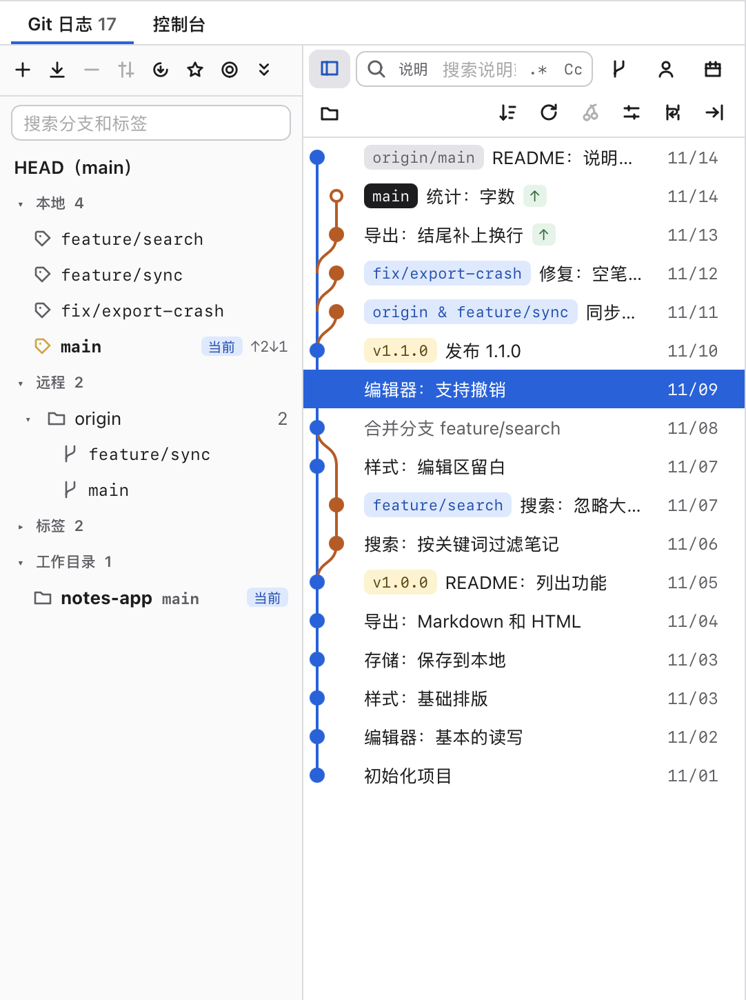

*图 3　过滤栏和带图谱的日志*

### 提交详情

选中一个提交后，右边从上到下是：操作图标行、改动的文件、差异框、作者和说明（图 4）。

- **双击提交**：在差异标签页里打开它的第一个文件。
- **单击文件**：在下面的框里看差异；**双击**或框上的展开图标：在差异标签页里打开，可以左右对比。
- 文件列表可以按目录树显示，文件名的颜色表示状态：蓝色修改、绿色新增、红色删除。
- 点版本号复制；右键提交的“复制”里还能复制短版本号或整段提交说明。→ / ← 跳到父提交、子提交；⌘D 在差异标签页里打开第一个文件。
- 右键提交可以拣选、重置、还原、修改说明、新建分支和标签等，用不了的项会说明原因。

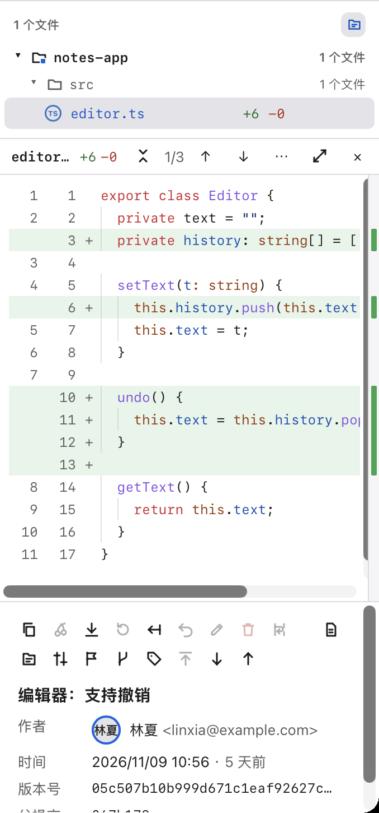

*图 4　提交详情和下方的差异框*

### 差异标签页

差异显示整个文件，没改的长段折叠成“⋯ 展开 N 行”。工具栏可以切换合并视图和左右对比、忽略空白、逐行追溯；⌥↑ ⌥↓ 跳到上一处、下一处改动，⌥← ⌥→ 切换同一提交里的上一个、下一个文件。右键差异可以开关语法高亮、彩虹括号、显示空白字符、行号和自动换行。

**彩虹括号**：代码里成对的 ()、[]、{} 按嵌套层级用不同颜色（四种颜色循环），同一对颜色相同，一眼看出哪个括号和哪个配对；字符串和注释里的括号不算。看整个文件或编辑时，缺了另一半的括号标成红色、带波浪线。文件、差异、逐行追溯和编辑器里都生效，在设置或差异的右键菜单里可以关掉。Markdown、HTML、Shell 脚本、YAML 这些文件里不着色。按 ⌘F 在差异里查找（回车下一个，⇧回车上一个），⌘L 跳到指定行。图片文件显示两边的图，可以并排、滑动或叠加着看。

### 比较两个版本

右键提交选“设为比较起点”，再点另一个提交，右边就列出两边各自独有的提交和有差异的文件。也可以右键分支选“和当前分支比较”，或右键提交选“和本地比较”。点过滤栏里“比较起点”标记上的 × 退出比较。

## 4. 提交改动

在左侧“提交”标签里勾选要提交的文件，甚至只勾其中几行，写好说明按 ⌘↵ 就提交了。不用先“暂存”：没勾的文件和行原样留在工作区。

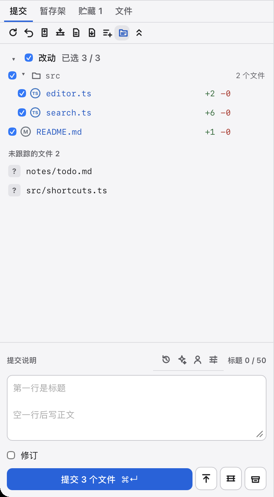

*图 5　提交面板：改动列表、未跟踪的文件和提交说明*

### 基本步骤

1. 在“改动”里勾选文件。“改动”这一行的勾选框是全选，旁边显示“已选 a / b”。
2. 在下面的说明框里写提交说明：第一行是标题，空一行再写正文。右上角显示标题字数。
3. 点“提交 N 个文件”或按 ⌘↵。旁边的小图标依次是“提交并推送”、“搁置到暂存架”和“贮藏”。

提交完在底部提示条上可以直接撤销，也可以随时按 ⌘Z。

### 只提交几行

单击改动列表里的文件，在中间打开它的差异（图 6）。每一行改动前面都有勾选框，每处改动的标题上有整处勾选。只勾了一部分行的文件，在列表里的勾选框显示为半选；提交后没勾的行还留在工作区。在这个差异里也可以直接改字并保存文件。

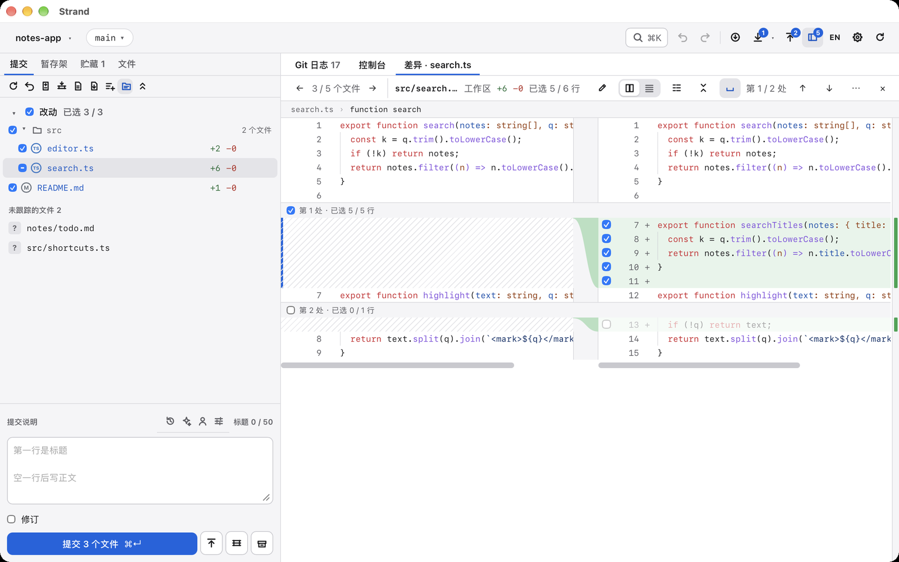

*图 6　在差异里只勾选几行来提交*

### 提交说明上方的图标

| 图标 | 作用 |
| --- | --- |
| 说明历史 | 翻出最近写过的说明，包括自己在这个仓库里的提交说明，点一条填入 |
| 生成说明 | 按勾选的改动拼出“修改 / 新增 / 删除 + 文件名” |
| 作者 | 这一次换个作者提交，或加共同作者（写成说明末尾的 `Co-authored-by` 行） |
| 提交选项 | 提交前格式化、提交前运行检查、加签名行；有开启的步骤时图标上有小圆点 |

仓库设置了 `commit.template` 时，说明框是空的就自动填入模板；模板原样没改不能提交。

### 一次处理几个文件

按住 ⌘ 单击可以多选文件，按住 Shift 单击选中一段，然后右键：勾选或取消勾选这几个文件、搁置、创建补丁、丢弃改动。未跟踪文件那一组标题旁有“全部移到废纸篓”，可以撤销。

### 修订上一次提交

勾上说明框下面的“修订”，主按钮变成“修订”。勾选的改动会并入上一次提交；说明不为空就替换原说明，为空就保留。旁边的下拉框还能选更早的、没推送的提交来并入。

### 变更列表

把改动分成几组分开提交。新建变更列表后，每个列表单独显示；新出现的改动进入“活动”列表。右键文件选“移到另一个变更列表”，把一个列表设为活动时只勾选它的文件。

### 丢弃改动和未跟踪的文件

- 文件行上的回滚图标丢弃这个文件的改动，确认后执行，可以撤销。
- 未跟踪的文件右键可以“加入版本控制”、“加入忽略规则”或“删除”（移到废纸篓）。
- 文件右键还有“在文件管理器中显示”和“用默认程序打开”。程序和脚本不会被直接运行，只在文件管理器里显示出来。提交详情、文件树和文件标签页里的文件也有这两项。

## 5. 分支

分支的全部操作有三个入口：工具栏的分支名（分支弹窗）、分支树的右键菜单、把一个分支拖到另一个上。三处的内容一样，挑顺手的用。

### 分支弹窗

点工具栏上的当前分支名（图 7）。上面是常用操作（更新项目、提交、推送、新建分支等），下面是本地分支和远程分支。直接打字搜索，↑ ↓ 选择，回车进入分支的子菜单，← 或 Esc 返回。搜索时还会列出“把 X 合并到当前分支”和“和 X 比较”。

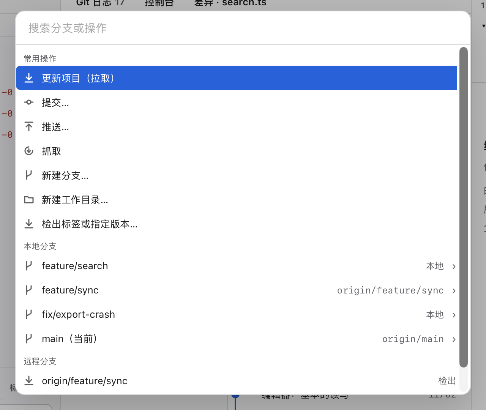

*图 7　分支弹窗：搜索分支，回车进入它的操作*

### 常用操作

| 想做什么 | 怎么做 |
| --- | --- |
| 切换分支 | 在分支树里双击分支，或分支弹窗里选“切换到这个分支”。双击远程分支会检出成本地分支 |
| 新建分支 | 分支树左侧的 ＋，或右键提交选“从这里新建分支” |
| 重命名、删除 | 右键分支。删除可以撤销，提交不会丢 |
| 合并到当前分支 | 右键分支选“合并到当前分支”，在确认框里选合并方式 |
| 变基 | 右键分支选“把当前分支变基到它之上…”。不能变基时这一项置灰并说明原因 |
| 只看一个分支 | 在分支树里单击它，再点一次取消 |
| 收藏 | 悬停分支点星号，收藏的排在最前面 |
| 在日志里找到分支 | 分支树左侧的定位图标 |
| 设置跟踪的远程分支 | 右键本地分支选“设置跟踪的远程分支…”，也可以选“不跟踪” |
| 删除远程分支、远程标签 | 右键远程分支选“删除远程分支…”；右键已推送的标签选“删除远程标签…”。都会先确认，不能撤销 |
| 清理已合并的分支 | 右键分支选“清理已经并入它的分支…”，或命令面板搜“清理已合并的分支”。列出所有已经并入它的本地分支，勾选后一次删掉，可以撤销 |

### 三种合并方式

- **能快进就快进**：默认。没有分叉时只移动分支，否则生成一个合并提交。
- **总是生成合并提交**：相当于 `--no-ff`，历史里保留分支的形状。
- **压缩成一个提交**：相当于 `--squash`，先弹出说明框，预填了要合并进来的提交标题。

上次选的方式会记住。有冲突时主界面换成冲突列表（见第 7 节）。

### 拖拽合并或变基

在分支树里按住一个分支拖到另一个本地分支上，鼠标旁边显示“X → Y”，松开后选合并还是变基。目标不是当前分支时，会先切过去再合并，整个算一步，撤销时一起回来。按 Esc 取消拖动。

### 变基前会先检查

变基前 Strand 会先算一下：会改写几个提交、目标上有几个新提交、有没有已经推送的。有已推送的提交时确认按钮变红，提醒你之后要强制推送。变基时工作区里没提交的改动会自动收起、完成后放回。

## 6. 和远程同步

工具栏的三个图标依次是抓取、拉取、推送。运行中的图标会转动，再点一次就取消。

| 操作 | 做什么 |
| --- | --- |
| 抓取 | 只下载远程的新提交，不改你的分支；远程已经删掉的分支也会从分支树里去掉。有好几个远程时，某个连不上不影响其他的，右下角会提示是哪个。打开仓库和窗口重新获得焦点时会自动抓取（可以在设置里关掉） |
| 拉取 | 抓取当前分支跟踪的远程后，把新提交并入当前分支（别的远程连不上也不影响）。图标右边的 ▾ 选“合并”或“变基”，按仓库记住 |
| 推送 | 打开推送对话框，先看清楚要推哪些提交再推 |

### 拉取前的冲突预演

拉取时 Strand 会先在内存里把合并或变基演一遍，不动你的仓库。没有冲突就直接拉取；会有冲突时弹出一个面板，列出新提交数、能自动合并的文件数和会冲突的文件。点“开始解决”才真正拉取，点“中止”什么都不改。

工作区有没提交的改动也能拉取：拉取前自动搁置到暂存架，拉完再放回来。放回时和拉下来的内容冲突的文件，留在暂存架的“拉取前自动搁置”里，之后手动取回。

### 推送对话框

对话框列出要推送的提交和推到哪个远程分支（图 8）。

- **强制推送**：使用 `--force-with-lease`，远程有别人推的新提交时会拒绝，不会覆盖。变基或改过已推送的提交后才需要。
- **同时推送标签**：只推还没推送的标签，括号里写着有几个。
- 仓库有多个远程时，可以选推到哪个。
- 提交面板的“提交并推送”提交完会直接打开这个对话框。

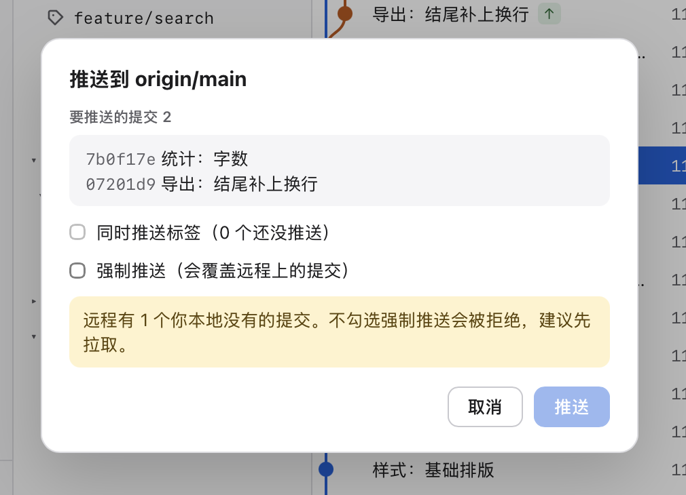

*图 8　推送对话框*

**只推送一部分**：右键一个还没推送的提交，选“推送到这里为止”，它之后的提交留在本地。

**输入密码**：Git 需要用户名、密码或 SSH 密钥口令时，Strand 会弹框询问，写明是哪个主机。输入的内容只交给这一次操作，Strand 不保存；想让系统记住，请配置 Git 的凭据助手（macOS 上是钥匙串）。后台自动抓取不会弹框打扰你。

**系统通知**：拉取、推送、抓取、克隆超过 3 秒，结束时 Strand 不在前台，会发一条系统通知。

**管理远程**：设置 → 远程 → “管理远程…”，可以添加、改地址、重命名、删除。

## 7. 解决冲突

合并、变基、拉取、拣选或取回暂存架遇到冲突时，中间换成冲突列表，逐个文件处理，最后一个文件解决完就自动完成。

### 冲突列表

列表里每个文件写着冲突的类型（内容冲突、一边修改一边删除、二进制文件等），上方显示“已解决 a / b 个文件”（图 9）。每个文件有三种处理办法：

1. **接受你的**：整个文件用当前分支的版本。
2. **接受对方的**：整个文件用合并进来的版本。
3. **合并…**：打开三栏合并窗口，一处一处选。

图片文件可以先点预览，看两边各是什么图。变基时冲突按提交逐个处理，可以跳过某个提交。暂时不想处理可以“稍后继续”，工具栏会一直显示“还有 N 处待处理”，点它回到冲突列表。

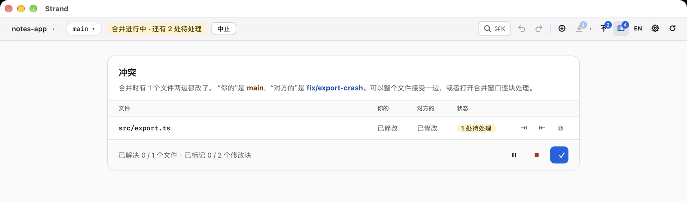

*图 9　冲突列表*

### 三栏合并窗口

左边是你的，中间是结果，右边是对方的（图 10）。

- 每处改动旁边有“接受”（»）和“舍弃”（×）两个按钮，两边都接受就把两段都放进结果。标记后约 0.6 秒自动跳到下一处。
- 顶部的“接受所有没有冲突的修改块”一次处理掉只有一边改了的地方。
- 结果栏可以直接编辑；⌘Z 撤销上一次标记。
- 右上角可以切换视图：三栏、只看两边对比、只看结果。
- 每处改动上写着引入它的提交，帮你判断该留哪边。
- 全部标记完点“应用”。

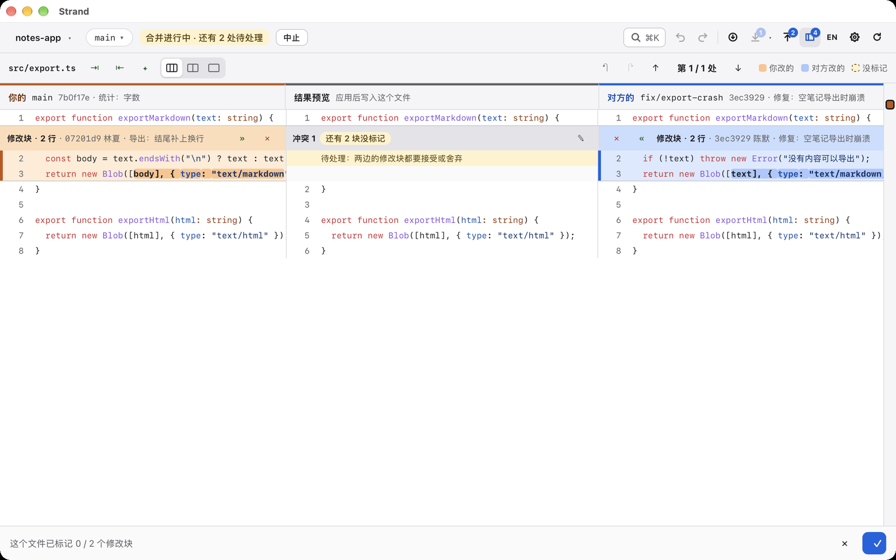

*图 10　三栏合并窗口*

### 中止

工具栏的“中止合并”（变基时是“中止变基”）回到开始之前。中止也能撤销：按 ⌘Z，冲突和已经处理好的文件都会回来。

## 8. 撤销和重做

Strand 给每个写操作记一笔，按 ⌘Z 撤销上一步，⇧⌘Z 重做。不只是提交：重置、变基、整理提交、删分支、丢弃改动、拣选、搁置、中止合并都能撤销。

### 操作时间线

日志底部的“最近操作”列出最近几步（图 11）。点其中一步，就回到这一步之前，它之后的步骤一起撤销。撤销过的步骤变灰，可以重做回来。工具栏的撤销、重做图标悬停会说下一步是什么。

*图 11　日志底部的操作时间线*

### 需要注意的地方

- **已经推送的步骤**：撤销它前会先问你。撤销后本地和远程不一致，要强制推送才能让远程也回去。
- **在别处改过**：如果你在命令行里切了分支或提交了，受影响的步骤会变灰并说明原因，不会误操作。
- **不记录的操作**：抓取、推送标签、更新子模块、Git 配置改动不能撤销；推送会记在时间线上，但不能撤销。
- **未跟踪的文件**：只有涉及它们的操作（比如连同未跟踪文件一起贮藏）会记下它们的内容。

### 操作记录（reflog）

时间线管不到的，到“操作记录”窗口里找：点时间线右边的“更多…”，或在命令面板搜“操作记录”。它列出 HEAD 或某个分支曾经指向过的提交，不在日志里的会标出来；从那一行新建分支就把丢掉的提交找回来了。

## 9. 暂存架和贮藏

两者都用来把没做完的改动先收起来，让工作区变干净。暂存架可以只搁置勾选的文件、只取回其中几个；贮藏就是 Git 自己的 `git stash`，和命令行互通。

| | 暂存架 | 贮藏 |
| --- | --- | --- |
| 收起哪些改动 | 勾选的文件 | 全部改动 |
| 未跟踪的新文件 | 可以一起搁置 | 可以一起贮藏 |
| 取回 | 整条或只取回勾选的文件 | 取回并删除，或取回但保留 |
| 命名 | 搁置时问名字，可以重命名 | 自动命名 |
| 存在哪里 | `.git/strand/shelf/`，只有 Strand 认识 | Git 的贮藏列表，命令行也能看到 |

### 搁置和取回

1. 在提交面板勾选文件，点提交按钮旁边的“搁置到暂存架”图标，输入名字。工作区里还有未跟踪的文件时，可以选“再加上 N 个未跟踪的文件”。不想起名字：用提交面板顶部的“直接搁置”。
2. 切到左侧“暂存架”标签（图 12），展开一条，点文件看它搁置了什么。
3. 点取回图标取回。只想要其中几个文件时，取消勾选其余的，图标会变成“取回勾选的 N 个文件”，剩下的留在暂存架。

取回时和工作区冲突，就进入冲突解决（第 7 节）。搁置和取回都能撤销。

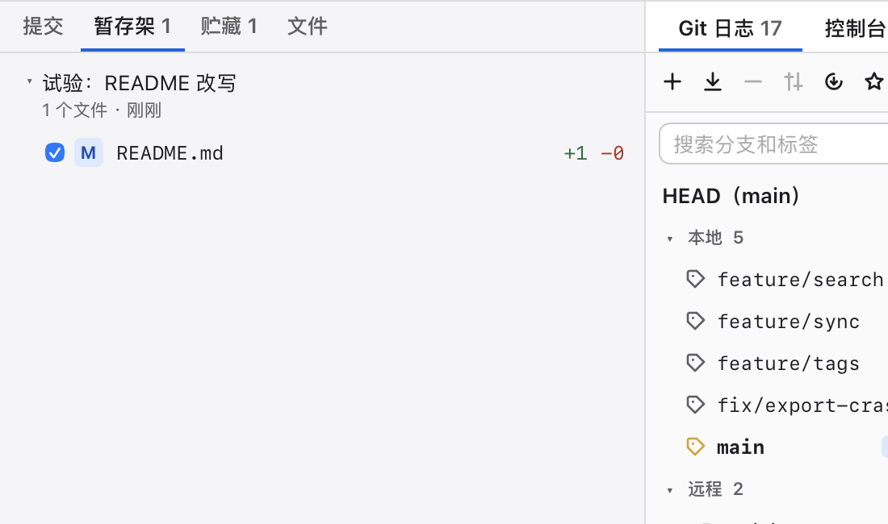

*图 12　暂存架：展开一条，勾选要取回的文件*

### 贮藏

点提交按钮旁边的“贮藏”图标。有未跟踪的文件时会问你：“只贮藏已跟踪文件的改动”还是“连同未跟踪的文件一起贮藏”。在左侧“贮藏”标签里展开一条可以看文件和差异，取回并删除、取回但保留，或丢弃。贮藏和现在的代码冲突时，用分支图标“新建分支并取回”：在贮藏时所在的提交上新建分支，把贮藏取回到那里。

## 10. 整理提交

推送前想把零碎的提交整理干净：调顺序、合并、删掉、改说明，都在整理窗口里一次完成，整个整理算一步，可以撤销。

### 打开整理窗口

右键一个提交选“从这里开始整理…”，或点过滤栏右边的整理图标（图 13）。窗口里最早的提交在最上面。

| 操作 | 怎么做 |
| --- | --- |
| 调整顺序 | 行左边的上移、下移 |
| 保留 / 并入上一个 / 丢弃 | 每行中间的三个图标；并入上一个就是把这个提交和上一行合成一个 |
| 改说明 | 点行上的铅笔，在下面的编辑框里改，⌘↵ 确定；改过的行标“已改说明” |

窗口底部实时显示“N 个提交整理后变成 M 个”。里面有已经推送的提交时会标出来并提醒：整理后要强制推送。可整理的范围在合并提交和其他分支也有的提交处止步。

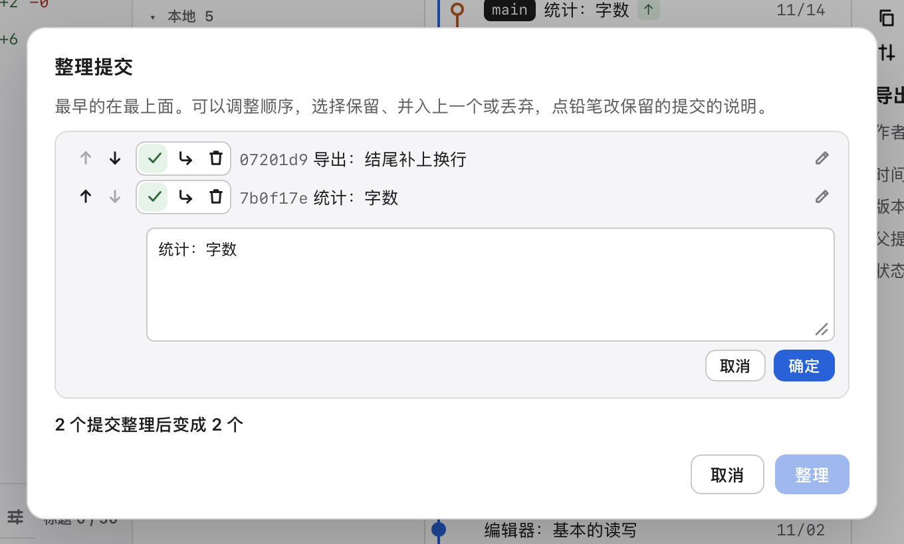

*图 13　整理窗口：调顺序、并入、丢弃、改说明*

### 不开窗口的快捷方式

- **修改说明**：选中提交按 F2。不是最新提交也可以，只要还没推送。
- **Fixup**：在提交面板勾选文件，右键一个更早的提交选“Fixup”，把这些改动并进去，说明不变。
- **Squash Into**：同上，只是并进去后会让你改说明。
- **压缩成一个**：⌘ 或 Shift 单击选中几个连续的提交，右键选“压缩成一个提交”，右边详情里也有这个按钮。
- **丢弃提交**、**撤销提交**：右键提交。撤销提交会把它的改动放回工作区。

## 11. 文件和逐行追溯

左侧“文件”标签列出项目里的所有文件，点一个就在中间开一个标签页看它的内容、每行是谁改的，以及它的修改历史。

### 找文件和搜内容

- **文件名**：目录树显示已跟踪的文件和没被忽略的新文件，有改动的文件会标出状态。上方搜索框按路径过滤。
- **Git 跟踪**：未跟踪的文件名和 `?` 标记用琥珀色显示，只有未跟踪文件的文件夹也用琥珀色。右键文件、文件标签或文件夹，可选择「加入 Git 跟踪」或「加入 Git 忽略规则」。对文件夹加入跟踪时，只暂存里面的未跟踪文件。忽略规则写入仓库根目录的 `.gitignore`，用于匹配未跟踪的文件。两种操作都能从操作时间线撤销。
- **内容**：切到“内容”，在工作区或某个分支、标签、版本里搜文字，支持正则和区分大小写。结果按文件分组，点一处就打开文件并跳到那一行。

### 按目录审查改动

目录右侧显示它和子目录中有改动的文件数，包括未跟踪的文件。右键目录（或按 Shift+F10）选择 **查看目录改动**，再用差异工具栏的上一个、下一个按钮或 `⌥←`、`⌥→` 在同一个标签页里逐文件审查。即使文件树正在按路径过滤，审查范围仍是整个目录。

同一个菜单里的 **移到变更列表** 可以把目录内已跟踪的改动移到已有列表，也可以新建列表。未跟踪的文件仍可在目录差异里查看。

### 回退单行改动

打开已跟踪文件的工作区原文或差异，修改行最左侧会出现 `↶`。点击可恢复该行在最近一次提交中的内容，或移除新增的一行。删除的行标成 `−行号`，点击同一入口可恢复。编辑器中也能用左侧的 `↶`，有未保存内容时先保存。回退只写工作区文件，暂存区保持原样，可以从通知里的「撤销」或操作时间线恢复。

### 文件标签页

每个文件一个标签，新标签开在当前标签右边，每个标签各自记得看到哪里。最多开 15 个，再开会关掉最久没看的那个。

| 操作 | 怎么做 |
| --- | --- |
| 关闭 | 标签上的 ×、鼠标中键、或 ⌘W |
| 重新打开刚关掉的 | ⇧⌘T |
| 最近的文件 | ⌘E，列出打开的和最近关掉的，可以搜索 |
| 关闭其他 / 左侧 / 右侧 / 全部 | 右键标签 |
| 调整顺序 | 拖动标签 |
| 查找、跳到行 | ⌘F、⌘L |
| 固定 | 右键标签选“固定标签页”；固定的排在最左边，关闭按钮变成图钉，“关闭其他”等不会关掉它 |
| 编辑 | 看工作区的当前内容时，点右上角“编辑”或双击某一行，就在标签页里改：按文件类型着色，⌘F 查找替换、⌘L 跳到行、⌘Z 撤销；默认自动保存（停止输入 1 秒后、结束编辑或离开编辑器时，可以在设置里关掉），也可以按 ⌘S 马上保存；“结束编辑”或 Esc 回到查看。没保存时标签上有圆点，关标签、切换仓库或关窗口前会先问 |

### 预览文件

有些文件看原文不方便，文件标签页右上角会出现“原文 | 预览”切换：

| 文件 | 预览成什么 |
| --- | --- |
| png、jpg、gif、webp、svg 等图片 | 图片，写着尺寸和大小，可以“适应窗口”或“原始大小” |
| Markdown（.md、.markdown 等） | 标题、表格、任务列表和带语法着色的代码块；支持标题锚点、仓库内图片和文档链接，外部链接用浏览器打开 |
| CSV、TSV | 表格，带行号，表头固定在上面 |
| JSON | 可以折叠展开的树 |
| PDF、音频、视频 | 直接看、直接听 |
| 设置了 textconv 的二进制文件 | 用仓库 `.gitattributes` 和 Git 配置里的转换命令转成的文字（比如 Word 文档转成纯文本） |

点切换旁边的 ▾ 可以换别的显示方式，或者打开“管理预览插件”。同一种扩展名会记住你上次选的。看历史版本时预览的也是那个版本。

**编辑 Markdown**：在工作区文件里点「编辑」，可切换三种模式。行内排版直接显示标题、粗斜体、任务清单、表格和仓库内图片，光标所在行显示 Markdown 标记。并排预览一边改原文、一边看实时排版，工具栏可开启或关闭同步滚动。原文模式适合精确修改语法。切换时保留光标和撤销历史，下次编辑会沿用上次选的模式。

「文档大纲」列出标题并能跳到对应源码行。「插入」可加表格、图片、代码块和引用。在编辑器里，`⌘B`、`⌘I`、`⌘K` 分别用于粗体、斜体和链接（Windows 用 `Ctrl`）。清单按回车会续写下一项。在行内排版中，直接点复选框会更新原文里的 `[ ]` 或 `[x]`。继续用 `⌘S`（Windows 上 `Ctrl+S`）保存，或沿用自动保存设置。

**粘贴图片**：把剪贴板里的图片粘贴到编辑区。比如在 `docs/README.md` 粘贴截图时，图片存到 `docs/README.assets/image.png`，光标处插入相对链接。同名图片会自动编号。按 `⌘Z`（Windows 上 `Ctrl+Z`）可以撤销链接编辑，图片仍可从 Git 的未跟踪文件列表处理。支持剪贴板提供的 PNG、JPEG、GIF、WebP、BMP 和 AVIF，每张最多 30 MB。

**预览插件**：想看更多种文件（比如 Jupyter 笔记本、自家的数据格式），可以装预览插件。在命令面板里搜“预览插件”打开管理窗口：

- “打开插件文件夹”：把含 `manifest.json` 和预览网页的插件子文件夹放进去，然后点「刷新」。可以按扩展名或完整文件名匹配，安装后无需重启。可用 [JSON Lines 示例](../examples/preview-plugins/json-lines/)试开 `.jsonl` 或 `.ndjson`。
- “新建示例插件”：生成一个十六进制查看器，可以照着它写自己的插件，代码里写了 Strand 怎样把文件交给网页。
- 插件写错了（比如 manifest.json 格式不对），窗口里会写出原因。

插件网页在沙箱里运行，只收到当前文件和文件元数据。关于清单、消息和示例，见 [预览插件开发说明](Preview%20Plugins.md)。

### 跳到定义和查找用法

在文件、差异或编辑器里看代码时：

| 想做什么 | 怎么做 |
| --- | --- |
| 跳到函数、类、变量的定义 | 按住 ⌘（Windows 上 Ctrl），名字下面出现下划线，单击就跳过去；或者把鼠标（编辑器里是光标）放在名字上按 ⌘B。会先看当前文件是从哪里 import 的，直接跳到那里 |
| 同名的定义有好几处 | 跳过去后会提示还有几处，按 ⌥⌘B 列出全部来选 |
| 打开 import 的文件 | ⌘ 单击引号里的路径，比如 `"./util/format"`、`#include "a.h"`；Rust 的 `mod foo;`、Python 的 `import a.b` 也行 |
| 查找用法 | 在名字上按 ⌥F7，列出所有用到它的地方 |
| 回到跳之前的地方 | ⌘[ 后退，⌘] 前进（编辑器里这两个键是缩进） |
| 按名字打开文件 | ⇧⌘O，输入文件名的一部分，比如 `fview` 就能找到 FileView.tsx |

Strand 是按文字搜索加 import 来找定义的，不需要装语言工具，大多数语言都能用。偶尔跳错（比如两个类有同名的方法），按 ⌥⌘B 看全部就好。

### 只检出需要的目录（稀疏检出）

超大仓库（比如几十个项目放在一起的 monorepo）里，你可能只关心其中几个目录。点“文件”标签搜索框旁边的文件夹按钮（或在命令面板里搜“稀疏检出”）：

1. 窗口里列出仓库的所有目录和各有多少文件，可以搜索。
2. 勾选要的目录，勾了上级目录下面的都会带上；底部会算出大约有多少文件。
3. 点“只检出选中的目录”，没勾的目录就从磁盘上拿掉了（根目录下的文件总会保留）。历史、分支、提交都不受影响。

之后“文件”标签上方会写着检出了哪些、多少文件，点“修改…”随时增减，或者“检出全部”恢复原样。如果有没提交的改动在要拿掉的目录里，Strand 会先列出来，提交或贮藏后再改。

克隆特别大的仓库时，可以在克隆窗口勾选“大仓库：只检出部分目录”：先只下载必要的内容、只检出根目录的文件，打开后再选要哪些目录。

### 修改链

点文件标签页右上角的“修改链 N”，左边列出改过这个文件的提交，最上面是“当前（工作区）”，改过名的也会跟着找下去。

- 单击一个版本：看这次提交对这个文件的修改，可以切到“这个版本的内容”。
- ⌘ 或 Shift 单击再选一个：比较这两个版本。
- ↑ ↓ 在版本之间切换。

从提交详情里文件行的“文件历史”图标打开时，修改链直接展开。

### 每行是谁改的

点文件标签页右上角的逐行追溯图标（或在全文上右键），每行左边显示最后改它的日期和作者（图 14）。底色越深表示越新，同一个提交里接着的几行文字稍淡，绿色的“还没提交”是工作区里的新改动。

- 悬停看提交的版本号、标题和时间，点一下在日志里定位。
- **往前追**：右键一行选“追溯改动之前的版本”，显示改这一行的提交之前的文件，同样带修改人，并停在这一行附近。可以一直往前追，点“← 返回”一步步回来。
- 差异里也有逐行追溯开关，删除的行按旧版本追溯。

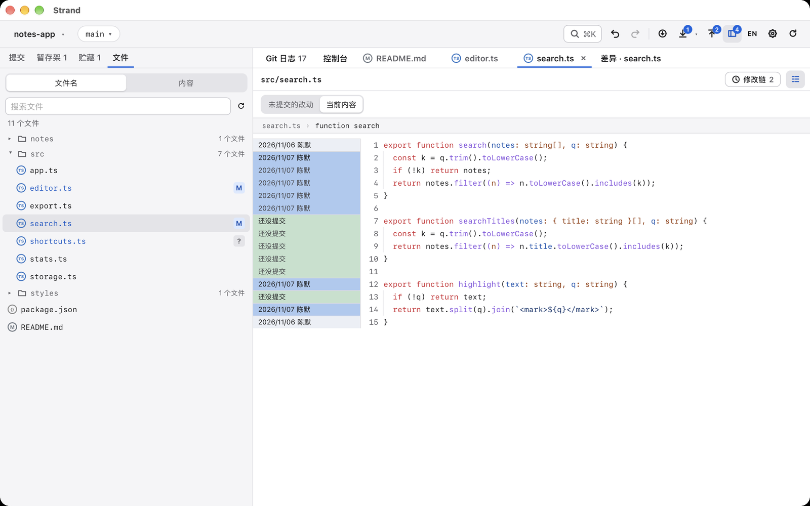

*图 14　文件标签页和每行的修改人*

## 12. 更多工具

### 命令面板

按 ⌘K（或点工具栏的搜索框）打开命令面板（图 15）。输入几个字就能找到几乎所有操作，同时也在搜提交说明和版本号。用不了的命令置灰并写明原因，右边显示快捷键。记不住某个功能在哪里，先在这里搜。

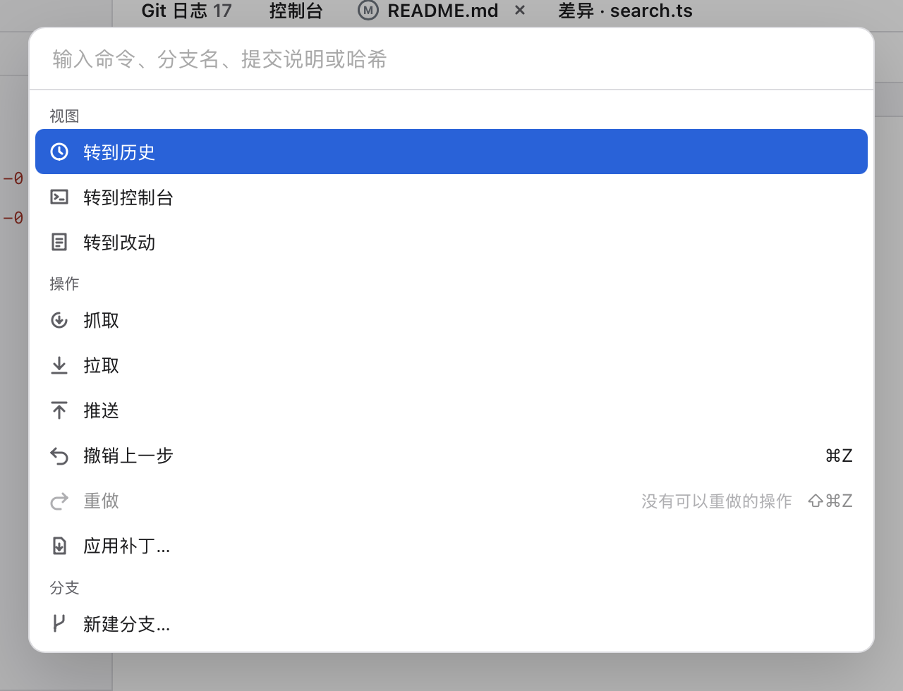

*图 15　命令面板*

### 在终端中打开

点工具栏最左边的仓库名，选“在终端中打开”（或在命令面板里搜），就在仓库文件夹里打开终端：macOS 上是“终端”，Windows 上是 Windows Terminal（没有时用命令提示符）。同一个菜单里还有“在文件管理器中显示”。

### 拉取请求和合并请求

仓库的 origin 在 GitHub 或 GitLab 上（包括公司自建的，主机名里带 github 或 gitlab）时，中间多一个“拉取请求”（GitLab 上叫“合并请求”）标签页。

- **列表**：开放的请求，显示编号、标题、作者、从哪个分支合到哪个分支、是不是草稿、多久前更新。单击一条看它的检查（CI）结果，还能检出它的分支、复制链接、在浏览器中打开；双击直接在浏览器里打开。
- **新建**：标签页右上角或命令面板里的“新建拉取请求…”。标题和说明默认取当前分支最新的提交，目标分支默认 main（没有就 master、develop），可以勾“作为草稿”。当前分支要先推送到 origin。
- **访问令牌**：Strand 用的是 Git 自己为这个网站存的密码或令牌。第一次如果提示“还没有这个网站的访问令牌”，点“输入访问令牌…”，按提示在网站上新建一个（GitHub 要 repo 权限，GitLab 要 api 权限）粘贴进来。令牌交给 Git 的凭据助手（如 macOS 钥匙串）保存，Strand 自己不留。

审阅、评论和合并请求还是在网页上做。

### 贡献统计

点工具栏最左边的仓库名选“贡献统计…”（或在命令面板里搜），看当前分支最近 30 天、90 天、1 年或全部历史里：

- 提交数、作者数、新增和删除的行数；
- 每月提交数，鼠标停在柱子上看具体数字；
- 一周里每天每个小时的提交多少（按作者自己的时区），颜色越深越多；
- 每位作者的提交数和占比、增删行数、第一次和最后一次提交的日期。点作者名，日志就只显示他的提交。

不算合并提交；同一个人用了不同名字或邮箱，可以用仓库里的 `.mailmap` 合并。

### 仓库维护

点工具栏最左边的仓库名选“仓库维护…”（或在命令面板里搜）：

- **大小**：.git 文件夹多大，其中打包的对象、松散的对象、能清掉的、Git LFS 文件、Strand 自己的数据各占多少。松散对象或包太多时会提示“建议清理”。
- **清理**：运行 `git gc`，把松散的对象打包、合并零碎的包、删掉早就找不回的对象，完成后告诉你省了多少。分支、标签、操作记录和撤销能回到的提交都不会删。大仓库可能要一会儿，可以随时停止。
- **记住冲突的解决方法**（rerere）：打开后，解决过的冲突再次出现时（比如反复变基、重新合并），Git 会按上次的方法自动改好，冲突列表里直接显示为“已解决”。Strand 不会替你自动完成，检查一下再点 ✓。只对这个仓库生效。

### 补丁

- **创建补丁**：右键提交选“创建补丁…”，或在提交面板顶部点“创建补丁”（用勾选的文件）。可以复制或保存成文件。
- **应用补丁**：把 .patch 文件拖进窗口，或在命令面板搜“应用补丁”后粘贴。先列出会改哪些文件、能不能应用；`git format-patch` 生成的补丁可以直接生成提交。

### 二分查找

知道某个旧版本没问题、现在有问题，想找出是哪个提交引入的：右键提交，在“用二分查找找出问题提交”里分别选“标为好的”“标为坏的”。之后日志上方出现提示条，告诉你当前检出的是哪个、大约还要几步；测试后点“好的”“坏的”或“跳过”，找到第一个坏提交后可以定位它。结束后回到原来的分支。

### 工作目录

想同时在两个分支上工作，又不想来回切换：右键分支选“在新工作目录中检出…”，它会被检出到仓库旁边的一个新文件夹（`git worktree`）。分支树最后的“工作目录”分组列出所有工作目录，双击就在 Strand 里切过去。

### 子模块

仓库里有子模块时，分支树最后有“子模块”分组，标出“未初始化”、“提交不同”（检出的不是记录的提交）、“有改动”。悬停点更新图标检出记录的提交（没初始化的会先初始化并克隆），双击在 Strand 里打开它。分组标题上的图标一次更新全部。

### Git LFS

用 Git LFS 管理的大文件，在差异、文件全文和图片对比里显示真实内容，而不是 LFS 的指针文件。内容还没下载的文件会提示一下，点“下载 LFS 文件”即可（需要电脑上装了 git-lfs）。LFS 文件请整个文件提交，不要只勾其中几行。

### Git 钩子

Git 钩子是 Git 在提交、合并、推送等时候自动运行的脚本，比如提交前跑 lint 的 pre-commit。点工具栏最左边的仓库名选“Git 钩子…”（或在命令面板里搜）：

- 左边列出所有钩子和状态：运行中、已停用、示例（Git 自带、还没生效）、没有。右边写着它是干什么的。
- 选一个就能在编辑器里看和改脚本，点“保存”生效。
- “停用”暂时关掉它（文件改名为 `pre-commit.disabled`），“启用”打开回来；示例钩子点“启用”会复制一份生效。
- pre-commit 这类钩子可以点“试运行”，马上看到它的输出和会不会拦下提交，不会真的提交。
- 如果钩子由 husky 之类的工具管理，窗口顶上会提醒你：在这里改的可能被它覆盖。

**钩子拦下提交时**，右下角弹出红色气泡，显示钩子的输出（比如 lint 报了哪些错）。可以“查看完整输出”，或者确定没问题时点“跳过钩子再提交”。想一直不跑钩子，在提交说明上方的提交选项里关掉“运行 Git 钩子”。

### 通知

操作完成后，右下角会弹出一个通知气泡，写着结果和细节，比如拉取后会写“从 origin/main 拉取了 2 个提交，3 个文件有改动”。气泡上的链接可以直接撤销、查看拉取下来的提交，或者在抓取后接着拉取。

- 绿色是成功，蓝色是一般信息，几秒后自动消失；鼠标停在上面时不会消失。
- 黄色是需要注意的（比如拉取遇到冲突）。
- 红色是出错，会一直留着，点“查看控制台”看是哪条命令出的错，或者“复制”错误信息。
- 错过了？在命令面板里搜“通知记录”，最近 100 条都在。

### 控制台

中间的“控制台”标签按时间顺序列出 Strand 执行的每一条 git 命令、用时和输出，失败的标红（图 16）。出问题时先来这里看是哪一步。密码和令牌会自动打码。同样的内容还写进本机日志文件（macOS 上在 `~/Library/Logs/app.strand.desktop/`），保留 7 天，不会上传。

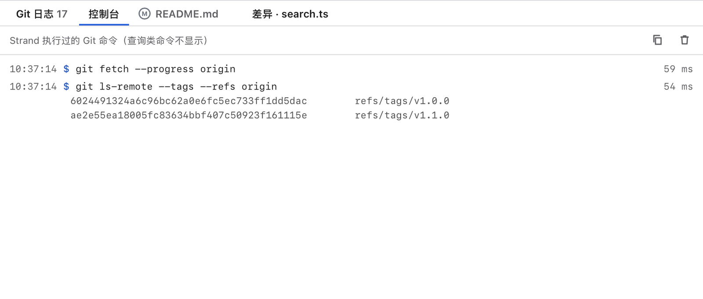

*图 16　控制台*

## 13. 设置和更新

点工具栏的齿轮或按 ⌘, 打开设置（图 17）。改动立即生效，点右上角 ×、“完成”或按 Esc 关闭。

| 分组 | 可以改什么 |
| --- | --- |
| 外观 | 语言（跟随系统 / 中文 / English）、主题（跟随系统 / 浅色 / 深色）、显示精确日期还是“3 小时前” |
| 远程 | 管理远程、自动抓取和最短间隔（5 / 15 / 30 分钟） |
| 提交 | 加签名行（Signed-off-by）、这个仓库的提交签名（GPG 或 SSH） |
| 启动 | 启动时打开上次的仓库（开着几个窗口就恢复几个） |
| 更新 | 自动检查更新、手动“检查更新”，显示当前版本 |
| 快捷键 | 修改命令面板、设置、撤销、查找、标签页、提交等快捷键 |
| 编辑 | 编辑文件时自动保存 |
| Git 配置 | 用户名、邮箱、代理、换行符、新仓库的默认分支名 |
| Git | 显示正在使用的 Git 版本 |

工具栏上的 EN / 中 按钮也能一键切换语言，不用重新打开仓库。

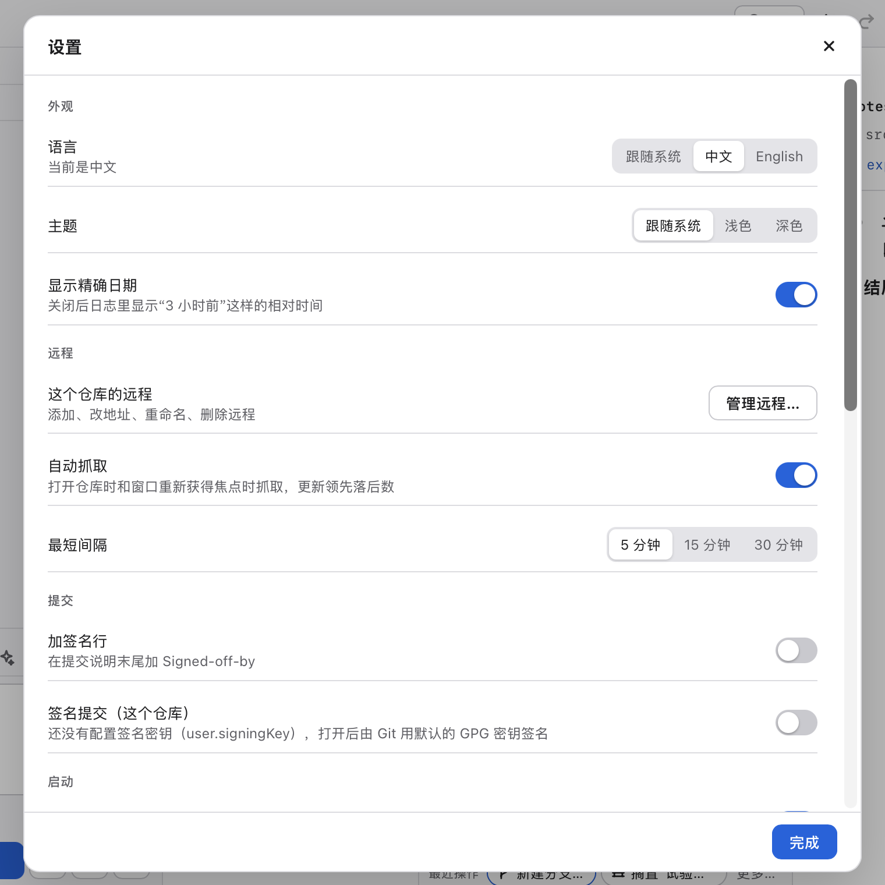

*图 17　设置窗口*

### Git 配置

打开了仓库时，先选改“全局”（对这台电脑上所有仓库生效）还是“这个仓库”（只对当前仓库，覆盖全局）。输入后按回车或离开输入框就保存，格式不对时下方会说明原因。

**代理**：填上地址（如 `http://127.0.0.1:7890`）就自动打开。开关关掉后 Git 不走代理，但填的地址留着，再打开就恢复。只给 https 地址用的代理单独一行。

### 自动更新

开着“自动检查更新”时，启动后几秒 Strand 会去 GitHub 看有没有新版本，有的话在右下角弹出卡片：

1. **下载并安装**：下载时显示进度，安装前核对签名，装好后自动重新启动。
2. **以后再说**：下次启动再提醒。
3. **跳过这个版本**：这个版本不再自动提醒，手动检查时还会显示。

没联网时自动检查会安静地失败，不打扰你。

## 14. 快捷键和常见问题

### 快捷键

Windows 上 ⌘ 换成 Ctrl，⌥ 换成 Alt。命令面板里的“查看快捷键”也能随时查。下表是默认的快捷键；在设置的“快捷键”里点一项后按新的组合键就能改（要带 ⌘ 或 ⌥，或者用 F1–F12），和别的冲突时会提示，也可以恢复默认。方向键、Esc、Shift+F10 这类固定不变。

| 快捷键 | 作用 |
| --- | --- |
| ⌘K | 命令面板 |
| ⌘, | 设置 |
| ⌘Z / ⇧⌘Z | 撤销 / 重做 |
| ⌘↵ | 提交（光标在提交说明里时） |
| ⌥⌘↵ | 提交并推送（光标在提交说明里时） |
| ⌘S | 保存正在编辑的文件（Windows 上是 Ctrl+S） |
| ⌘F | 搜索日志；在差异或文件里是查找 |
| ⌘L | 在差异或文件里跳到行 |
| ↑ / ↓ | 日志里选上一个、下一个提交 |
| → / ← | 跳到父提交、子提交 |
| F2 | 修改选中提交的说明 |
| ⌘D | 在差异标签页里打开选中提交的第一个文件 |
| ⌥↑ / ⌥↓ | 差异里上一处、下一处改动 |
| ⌥← / ⌥→ | 差异里上一个、下一个文件 |
| ⌘W | 关掉当前文件或差异标签页 |
| ⇧⌘T | 重新打开刚关掉的文件 |
| ⌘E | 最近的文件 |
| ⌘B / ⌘ 单击 | 跳到定义（或打开 import 的文件） |
| ⌥⌘B | 列出所有同名的定义 |
| ⌥F7 | 查找用法 |
| ⌘[ / ⌘] | 后退 / 前进到跳转过的位置 |
| ⇧⌘O | 按名字打开文件 |
| Shift+F10 | 在分支、提交或文件上打开右键菜单 |
| Esc | 关闭对话框、菜单或面板 |

### 常见问题

**提交时说没有身份、提交失败**
还没设置用户名和邮箱。点提交面板上的“去设置”，或在设置 → Git 配置里填上。

**每次拉取、推送都要输密码**
Strand 不保存密码。配置 Git 的凭据助手（macOS 上的钥匙串、Windows 的 Git Credential Manager），或改用 SSH 地址。

**误删了分支、重置掉了提交**
先按 ⌘Z。太久以前或在命令行里做的，到“操作记录”窗口里找到那个提交，从它新建分支（第 8 节）。

**想知道 Strand 到底执行了什么**
看中间的“控制台”标签，每条 git 命令和输出都在那里。

**窗口里没显示刚在命令行里做的改动**
Strand 会自动发现大部分改动；万一没刷新，点工具栏最右边的“重新读取仓库”。

**按钮灰着点不了**
把鼠标停在上面，提示里写着为什么。常见原因：合并或变基还没完成、提交已经推送、网络操作进行中。

**反馈问题**
到 [GitHub](https://github.com/calabli/Strand/issues) 提 issue，附上控制台里出错的那几行会很有帮助。
